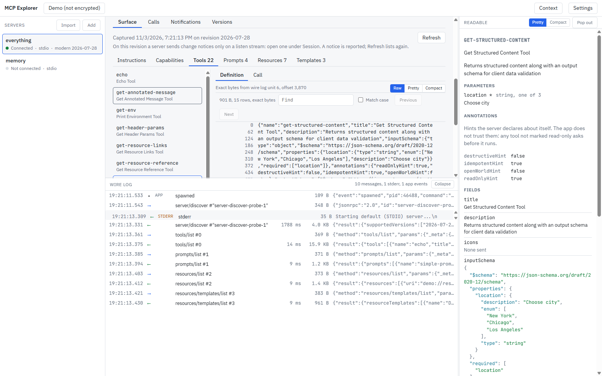
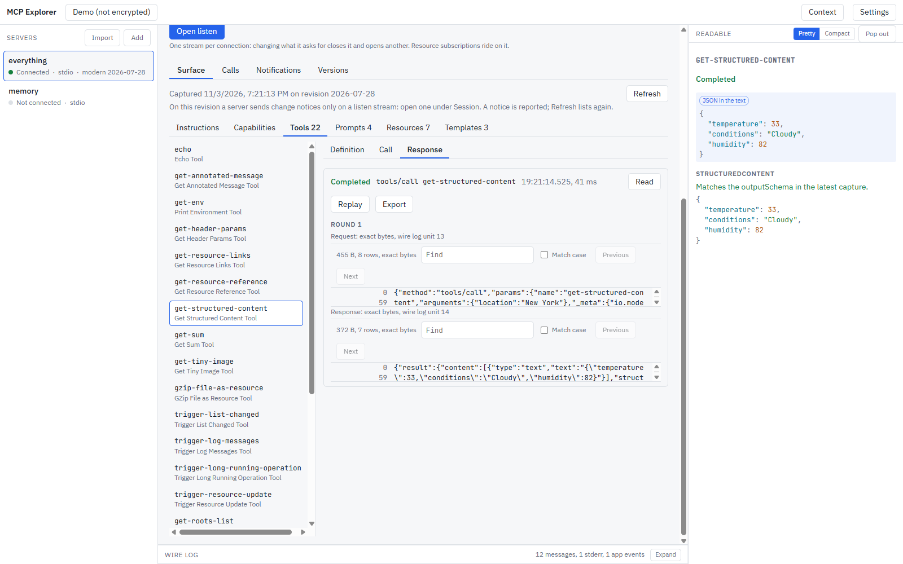
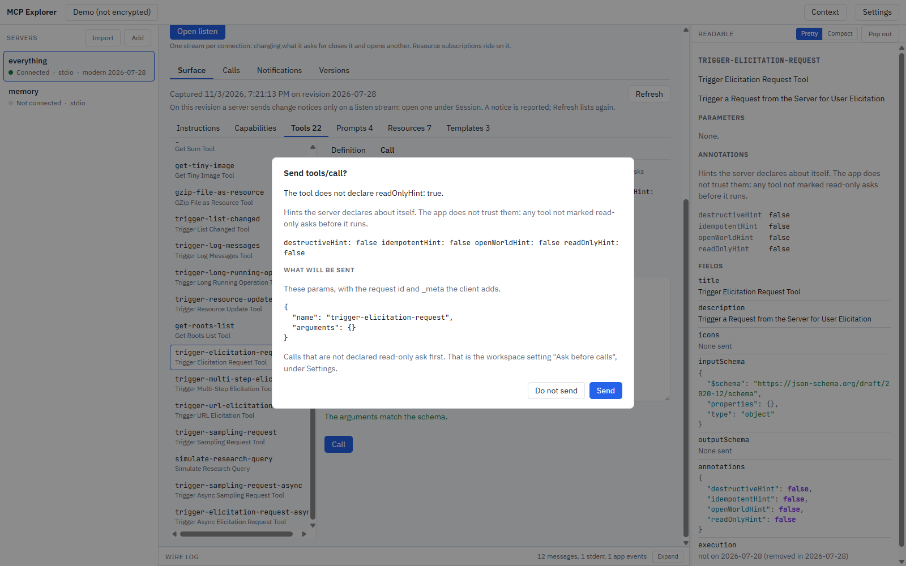
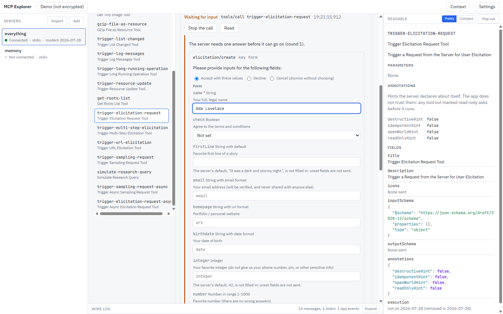
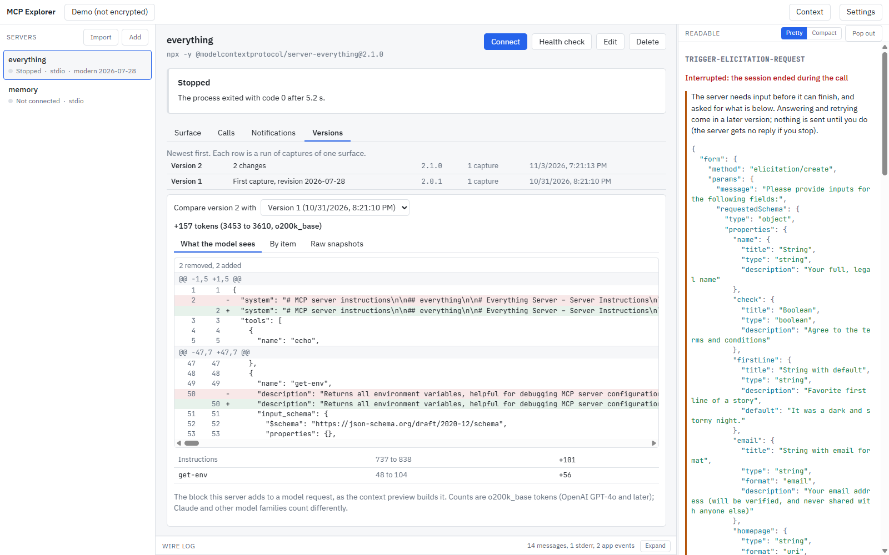
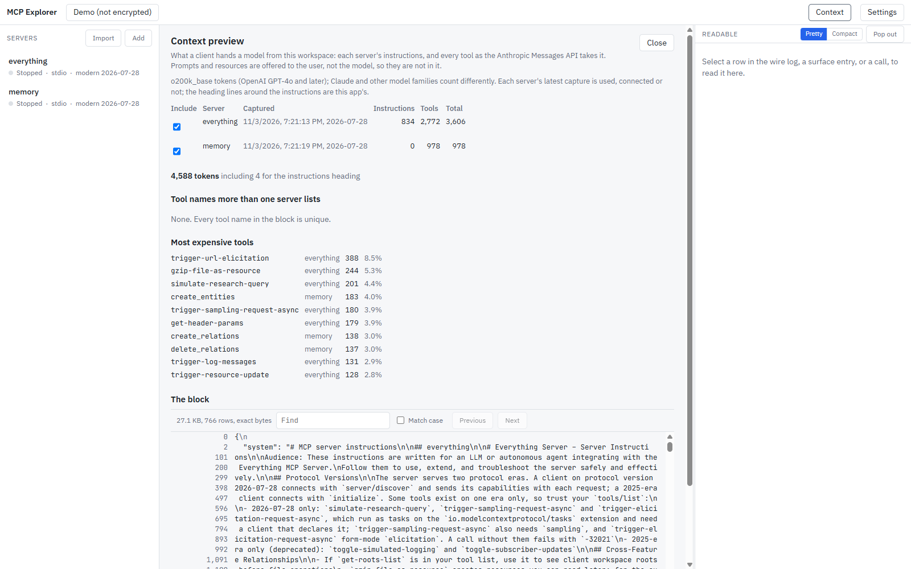

[](https://m8ven.ai/mcp/mtgeekman/mcp-explorer?s=readme)

# MCP Explorer

A desktop workbench for [Model Context Protocol](https://modelcontextprotocol.io)
servers. Connect to a local `stdio` server or a remote HTTP one, see everything
an agent would see, call its tools by hand, read every byte on the wire, and find
out what a new release of a server actually changed.



MCP Explorer has no model and no API key. Nothing happens that you did not
do: no background calls, no automatic retries, and no automatic answers to a
server that asks for input. When a server asks for a sampling completion, you
type it.

**Status:** 0.2.0. Windows and Linux.

This GitHub repository is a read-only mirror of a private GitLab project. It is
overwritten from there on each release, so pull requests and commits made here
cannot be merged.

## What it does

### The whole surface, as the server sent it

Instructions, capabilities, tools, prompts, resources and resource templates,
captured on every connect. A definition opens on the exact bytes it arrived in,
with readable Pretty and Compact views one click away, and a readable pane that
lays out parameters, annotations and every field. A field the connected
protocol revision cannot carry is labelled as such, never shown as missing.
Malformed entries are flagged rather than dropped.

### Every revision, both eras

MCP Explorer speaks every published protocol revision, `2024-11-05` through
`2026-07-28`: the legacy `initialize` handshake and the modern `server/discover`
era, including surfaces later revisions deprecated (sampling, roots, tasks). The
era is detected once and remembered, so a `stdio` server is not started twice to
find out.

### Calls through generated forms



Tools, prompts and resources are called through forms generated from their
schemas, with the JSON editor always beside the form. The transcript shows the
exact request and response bytes; the readable pane shows the result, checks
`structuredContent` against the tool's `outputSchema`, and renders every content
type. Progress shows while a call runs, and Cancel sends the cancellation.



A tool that does not declare `readOnlyHint: true` asks first and shows exactly
what will be sent. Annotations are hints from the server, and the app treats
them that way.

### A person answers the server's questions



When a server needs input mid-call, whether as a modern multi-round-trip result
or as a legacy server-to-client request, the call waits for you: sampling,
form and URL elicitation, and roots. Server defaults are shown, never filled in
for you. Nothing is retried until you send your answer.

### Versions and what changed



Every capture is kept. Captures of the same surface collapse into one version,
a version bump with an identical surface is marked as identity only, and any two
versions can be compared three ways: what the model sees (with the token delta),
item by item (down to the JSON path that changed), and the raw stored
snapshots.

### The context an agent pays for



The context preview builds the block a client would hand a model from every
server in a workspace, counts its tokens, lists the most expensive tools, and
flags tool names that collide across servers. Counts use `o200k_base`; other
model families count differently, and the screen says so.

### And the rest

- Transports: `stdio`, Streamable HTTP, and the deprecated HTTP+SSE.
- OAuth sign-in, one visible step at a time: discovery, dynamic or
  pre-registered client registration, a browser sign-in with PKCE, refresh, and
  sign-out. Token and secret values are redacted in the wire log. Verified
  against a test authorization server; testing against hosted providers is
  under way.
- Session controls: log level, subscriptions and listen streams, ping,
  completions with a Suggest button, a notifications timeline, and a one-press
  health check.
- Server definitions imported from the config files of Claude Desktop, Claude
  Code, VS Code and Cursor, with each one reviewed before it is saved.
- Encrypted workspaces: keys held by the OS keychain or derived from a
  passphrase, a recovery key, and server secrets that are never readable on
  disk. An unencrypted workspace never stores a secret.
- Retention limits by age and size, with a preview of what a purge removes.
- Server process trees are ended whole on disconnect and on quit.

## Install

Download from [Releases](https://github.com/mtgeekman/MCP-Explorer/releases):
for Windows a zip (unzip it into a folder of its own and run
`MCP Explorer.exe`; there is no installer), for Linux an AppImage or a `.deb`.
Or build from source.

To build, you need: Node.js 24 or later, and git. No compiler is needed: the native
modules ship prebuilt binaries.

```bash
git clone https://github.com/mtgeekman/MCP-Explorer.git
```

```bash
cd MCP-Explorer
```

```bash
npm ci --ignore-scripts
```

```bash
node node_modules/electron/install.js
```

```bash
npm start
```

`npm start` builds, then opens the app. `--ignore-scripts` matters: one dependency declares a `node-gyp rebuild` install
step that the prebuilt binary makes unnecessary, and skipping it keeps the
install from needing a compiler. Because it also skips Electron's own download,
`install.js` fetches the Electron binary by hand.

To package: `npm run dist:win` (a zip of the app) or `npm run dist:linux`
(AppImage and `.deb`). On Windows, `scripts/build.ps1` builds the unpacked app
into `release/win-unpacked`.

## Develop

```bash
npm test
```

The unit and integration suite, `node:test` with no framework. It runs against
a deliberately hostile fixture server in `scripts/fixture/` that speaks both
eras on every transport.

```bash
npm run test:smoke
```

Drives the real app through Playwright after `npm run build`. It needs a display;
CI runs it under Xvfb on Linux.

```bash
npm run dev:renderer
```

The renderer with hot reload. Start Electron alongside it with
`VITE_DEV_SERVER_URL=http://localhost:5199`.

The screenshots above come from `node scripts/screenshots.mjs`, which drives
the built app against `@modelcontextprotocol/server-everything` and
`@modelcontextprotocol/server-memory`, fetched with `npx`.

## Layout

- `packages/protocol` - the Electron-free core: the SDK adapter, the only
  module that writes a JSON-RPC frame, and the byte tap that feeds the wire
  log; surface capture, canonical hashing and diffs; OAuth; the tokenizer.
- `packages/storage` - encrypted SQLite workspaces, migrations, history,
  snapshots, retention, and the keychain.
- `packages/platform` - process-tree handling per OS, and where other clients
  keep their config files.
- `packages/backend` - the plain Node host that runs in an Electron utility
  process: connections, calls, sessions, sign-in.
- `app` - the Electron main process, the backend host, and the React renderer.

Built on the official
[`@modelcontextprotocol/client`](https://www.npmjs.com/package/@modelcontextprotocol/client)
SDK.

## Platforms

Windows and Linux are built and tested in CI. macOS is not built yet; the code
is written not to rule it out.

## License

[MIT](LICENSE). The app bundles the IBM Plex Sans and JetBrains Mono fonts,
which are under the SIL Open Font License 1.1.
